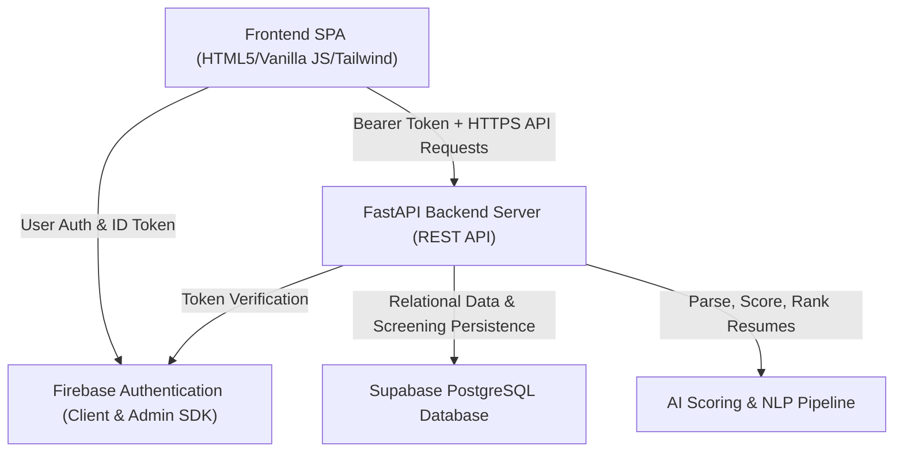

# Nipun AI Resume Screener & Ranking System — High-Level Architecture

## System Overview
Nipun is an AI-powered resume screening, ranking, and talent evaluation platform with distinct workflows for Recruiters and Candidates.

---

## Major Components & Services

1. **Frontend Client Application**
   - Single Page Application (SPA) built using semantic HTML5, Vanilla JavaScript modules, and Tailwind CSS.
   - Distinct role-based interfaces:
     - **Recruiter Workspace**: Resume screening, scoring profile selection, job description library management, candidate quick-view analysis, profile editing, and screening history runs.
     - **Candidate Workspace**: Single-resume optimization against job descriptions, ATS scoring, and targeted remediation recommendations.
   - Hosted on Firebase Hosting.

2. **Backend API Service**
   - Built on FastAPI (Python 3.11).
   - Exposes RESTful endpoints for authentication verification, onboarding, recruiter workflows, candidate analysis, and screening history.
   - Enforces rate limiting, role-based authorization, and user resource isolation.
   - Hosted on Render.

3. **AI / NLP Analysis & Scoring Pipeline**
   - Modular multi-stage processing pipeline for candidate resumes:
     - **Text Extraction**: PyPDF2 / python-docx.
     - **NLP Preprocessing & Skill Extraction**: spaCy entity recognition and canonical skill ontology matching.
     - **Scoring & Ranking Engine**: Weighted hybrid scoring (skill match, semantic similarity, experience tenure, education, projects) driven by configurable scoring profiles.
     - **Explainable AI (XAI)**: Grounded evaluation powered by Google Gemini API (with ordered multi-model resilience: `gemini-3.5-flash-lite` as primary, falling back to `gemini-2.5-flash-lite`, `gemini-flash-latest`, and deterministic rule-based fallback). Produces grounded alignment summaries, key strengths, skill gaps, and component scoring rationales.
     - **Resume Improvement Recommendations**: Targeted actionable recommendations with estimated ATS score gains, resolved status lifecycle, and candidate acceptance tracking.

---

## Primary Data Stores

- **Supabase PostgreSQL**
  - **`users`**: User identity, role (`RECRUITER`, `CANDIDATE`, `UNASSIGNED`), Firebase UID, display name, and profile completion status.
  - **`recruiter_profiles`** & **`candidate_profiles`**: Role-specific profile attributes (company details, domain focus, career status).
  - **`job_descriptions`**: Saved job descriptions created by recruiters.
  - **`scoring_profiles`**: Configurable evaluation weight profiles for distinct roles and experience levels.
  - **`screening_tasks`**: Recruiter-scoped history records storing completed screening run metadata (timestamp, job role, complete job description, resume count, and sanitized candidate ranking metrics).
  - **`resumes`** & **`scan_results`**: Normalized resume records and candidate scan results.

---

## Authentication & Authorization Boundaries

- **Identity Provider**: Firebase Authentication is the single source of truth for user credentials, email/password, and Google OAuth login.
- **Backend Verification**: Every protected backend endpoint validates incoming `Authorization: Bearer <token>` headers via the Firebase Admin SDK.
- **Role Enforcement & Data Isolation**:
  - Backend dependencies (`require_recruiter`, `require_candidate`) enforce role boundaries.
  - Recruiter screening history, library job descriptions, and profile data strictly enforce ownership (`resource.recruiter_id == current_user.id` or `resource.owner_id == current_user.id`), preventing unauthorized cross-user data access.

---

## Deployment Boundaries

- **Frontend**: Static web assets deployed to **Firebase Hosting**.
- **Backend**: Containerized/WSGI FastAPI application running on **Render**.
- **Database**: Cloud-managed PostgreSQL hosted on **Supabase**.
